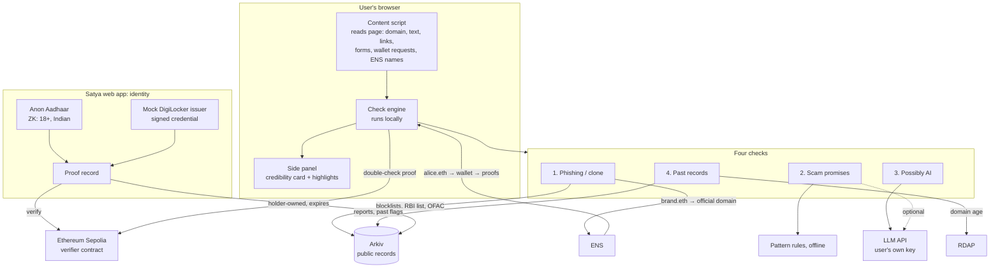

# Satya: Architecture and Build Plan

**Satya (सत्य, "truth"): a browser extension that tells you whether the website or person
in front of you is real, with reasons and proofs, not guesses.**

Built solo at ETHGlobal Mumbai. Deadline: **Sat 7 Nov 2026, 09:00 AM IST.**
Partner prizes: **ENS, Arkiv, Ethereum Foundation** (Chainlink CCIP only if time is left).

---

## 1. The idea in simple words

You open a website or someone's profile. Satya's side panel answers three questions:

1. **Is this site real?** Is it a known phishing site, a clone of a real brand, or on a
   government fraud list?
2. **What is it saying?** It highlights risky lines ("guaranteed 3x returns", "enter your
   seed phrase") and content that may be AI-generated.
3. **Is this person real?** If they've linked an ENS name, it shows their proofs:
   ✅ 18+ · ✅ Indian · ✅ owns this handle. No personal data is shown, only proofs.

It works both ways:
- **People check companies:** is this site verified, flagged, or brand new?
- **Companies check people:** a site can ask "is this visitor 18+?" and get a proof back,
  without collecting their ID.

Everything ends in a **credibility card**: a score plus the exact reasons behind it, each
with its source.

---

## 2. Why now (pitch)

- **AI fakes everything.** $15 fake passports, deepfake kits that pass selfie checks,
  AI-written scam sites.
- **Leaked ID data gets people hurt.** CertiK counted 52 physical "wrench attacks" on crypto
  holders in H1 2026, helped by leaked KYC data.
- **India-specific:** fake forex and investment apps (the RBI keeps an Alert List of
  them), and the DPDP Rules now require age checks without hoarding children's data.

**Satya's angle:** existing tools (Scam Sniffer, Wallet Guard, Blockaid) only say "this is
bad." Satya also **proves what's real**: verified brands via ENS, verified people via
zero-knowledge proofs.

---

## 3. Data: what's real and what's demo

**Rule:** we only use information that is **already public**, and we never claim
something about a real person that we can't prove.

### Real public data (shown as-is, with its source)
| Data | Source | Used for |
|---|---|---|
| Known phishing domains | MetaMask `eth-phishing-detect`, OpenPhish community feed, ScamSniffer scam database (check each license before republishing) | Phishing check |
| Unauthorised forex / investment platforms | **RBI Alert List** (published by the Reserve Bank of India) | "Site promises returns" check |
| Sanctioned wallet addresses | **US Treasury OFAC SDN list** (public domain) | Fraud wallet check |
| Domain age and registration | **RDAP** (public WHOIS replacement, no key needed) | Past records |
| Real brands' official domains | ENS records (e.g. a brand's ENS name → its website) | Clone detection |
| Real public ENS profiles | ENS text records (e.g. `com.twitter`) | "This ENS name owns this handle" |

**For real people, Satya only says what is proven or listed**, e.g.
"no Satya proofs yet" or "this wallet is on the OFAC sanctions list (source: US Treasury)".
It never says "not 18" or "fraud" about a real person on its own judgment.

### Demo data (clearly labelled)
- **Team and opt-in volunteers:** real proofs (Anon Aadhaar test mode, mock DigiLocker).
- **Demo personas:** a fake "crypto guru" bot profile, a minor trying to pass as 18+,
  a fake investment site. All labelled **DEMO**.

---

## 4. Architecture



**Trust rule:** Arkiv is where records are **found**; anyone can write to it. Proofs are
always re-checked against the verifier (onchain or by the proof library) before Satya
shows a ✅.

---

## 5. Components

### 5.1 Browser extension (Chrome, Manifest V3)
- **Content script:** pulls domain, visible text, links, forms (password / seed-phrase
  fields), and any ENS names or handles on the page.
- **Check engine:** runs the four checks, combines them into a score with reasons.
- **Side panel:** the credibility card, plus inline highlights on risky lines.
- **Settings:** optional LLM API key (stored locally; no Satya server).

### 5.2 The four checks

| # | Check | How | Output example |
|---|---|---|---|
| 1 | **Phishing / clone** | Domain vs blocklists on Arkiv. Lookalike check vs verified brand domains from ENS (edit distance, homoglyphs like `unlswap`). Page title/logo says brand X but domain ≠ X's ENS-linked domain | ❌ "Looks like Uniswap, but isn't the domain linked to uniswap.eth" |
| 2 | **Scam promises** | Offline pattern rules: guaranteed returns, urgency, seed-phrase requests, "send X get 2X", unregistered investment claims. Match against RBI Alert List names | ⚠️ "Promises 'fixed 5% daily returns'" + highlight |
| 3 | **Possibly AI** | LLM reads page text/profile bio, returns *signals*, never a verdict | ℹ️ "Possibly AI-generated (low confidence)" |
| 4 | **Past records** | RDAP domain age, past flags and user reports on Arkiv, OFAC wallet matches | ⚠️ "Domain registered 6 days ago" |

**Score:** start at 100, subtract per finding (weights in one config file), and always
show the reasons and sources. A verified ENS brand domain sets a ✅ floor.

### 5.3 Satya web app (identity)
- Connect wallet → see ENS name.
- **Prove:**
  - **Anon Aadhaar** (real ZK from the Ethereum Foundation's PSE team): proves 18+ and/or
    Indian from the Aadhaar QR, nothing else revealed. Use **test mode** for the demo.
  - **Mock DigiLocker issuer:** a clearly labelled demo signer that issues a signed
    credential (age, ID valid), standing in for real DigiLocker access, which needs
    government partner approval.
- **Link a handle:** set the ENS text record `com.twitter` (or `com.github`) to your handle,
  and put your ENS name in that profile's bio. The two-way link proves ownership.
- Writes a **proof record** to Arkiv, owned by the holder's wallet, **expiring with the
  credential**.

### 5.4 "Companies check people"
- A tiny demo site with a **"Verify with Satya"** button: asks the visitor's wallet for an
  18+ proof, checks it, and grants access. The site never sees an ID.

### 5.5 Arkiv (records layer)
| Entity | Fields (no personal data) | Expiry |
|---|---|---|
| `site_record` | domain, status, source, reasons, checkedAt | 30 days, refreshed by import |
| `address_label` | address, label, source | Long |
| `report` | target, reason, reporter wallet | 90 days |
| `proof_record` | holder, claimType, issuer, proofRef | **= credential expiry** |
| `brand` | ensName, officialDomain | Long |

Import scripts (re-runnable) load the public lists into Arkiv.

### 5.6 ENS
- **Brands:** `brand.eth` → official domain. Basis of clone detection.
- **People:** `alice.eth` → wallet → proof records; `com.twitter` record → handle link.
- Verified via live ENS lookups, no hard-coded values.

### 5.7 Ethereum Foundation (CROPS)
- **Privacy is the lead property:** checks run locally in the extension; identity is
  proven with ZK; no Satya server sees what you browse; no trackers.
- Trade-offs stated in the README: the optional LLM call sends page text to the LLM
  provider (off by default); RDAP and Arkiv lookups reveal domains being checked.

---

## 6. Tech stack

| Part | Choice |
|---|---|
| Monorepo | pnpm workspaces |
| Extension | TypeScript + React + Vite (MV3) |
| Web app | Next.js |
| Contracts | Foundry (only if a custom verifier is needed; Anon Aadhaar ships its own) |
| Records | `@arkiv-network/sdk`, Arkiv testnet (chain ID 7794095) |
| ENS | viem ENS helpers on Sepolia / mainnet reads |
| Identity | `@anon-aadhaar/react` (test mode) + mock issuer (ethers/viem signatures) |

```
satya/
  apps/extension/     content script, check engine, side panel
  apps/web/           identity app + "Verify with Satya" demo site
  packages/checks/    the four checks + scoring (shared, unit-tested)
  packages/arkiv/     schema + read/write helpers
  scripts/import/     load phishing feeds, RBI list, OFAC into Arkiv
  arkiv/              schema.md, why-arkiv.md, how-you-use-arkiv.md, reach.md, friction.md
```

---

## 7. Build plan (solo, ~12 hours)

Commit after every step: steady history matters, and one giant commit can disqualify.

| Hours | Step | Done when |
|---|---|---|
| 0–1 | Repo, license (MIT), scaffold extension + web app, Arkiv faucet + key | Extension loads in Chrome; Arkiv write works |
| 1–3 | **Check 1: phishing / clone** + import scripts (phishing feeds, RBI list, OFAC) | Known phishing site shows ❌ with source; lookalike of a brand shows ❌ |
| 3–4 | **Check 2: scam promises** (offline rules) + inline highlights | Demo investment scam page shows highlighted lines |
| 4–5 | **Check 4: past records** (RDAP age, Arkiv reports) + **score** | Card shows score with reasons |
| 5–7.5 | **Identity:** mock DigiLocker first, then Anon Aadhaar test mode; proof records to Arkiv | Your own profile shows ✅ 18+ ✅ Indian |
| 7.5–8.5 | **ENS:** brand domains, handle linking, profile lookup in extension | Profile page shows proofs via ENS name |
| 8.5–9 | **Check 3: possibly AI** (LLM, user's key) | Signal shown with "low confidence" wording |
| 9–10 | README with CROPS section, `/arkiv/*.md`, AI disclosure, feedback notes | A stranger can run it from the README |
| 10–11 | Demo video (≤ 3 min), deploy web app | Video recorded, live link works |
| 11–12 | Buffer, **submit before 09:00 AM** | Submission confirmed |

### Cut order if behind
1. "Companies check people" demo site.
2. Check 3 (AI detection).
3. Anon Aadhaar (keep mock DigiLocker).
4. **Never cut:** Check 1, the credibility card, one working proof via ENS + Arkiv, the
   video.

---

## 8. Demo script (3 minutes)

1. **Real vs fake site (45 s):** open a real brand site → ✅ verified via ENS. Open a known
   phishing clone → ❌ "not the domain linked to brand.eth", "domain 6 days old".
2. **Scam promises (30 s):** a fake investment page → highlighted "guaranteed daily
   returns", ⚠️ name matches the RBI Alert List.
3. **Real vs fake person (60 s):** two profiles, same name and photo. The real one:
   ✅ 18+ ✅ Indian ✅ owns handle, via ENS + ZK. The fake: no proofs, ℹ️ bio possibly AI.
   A minor's proof attempt fails: "the proof can't lie."
4. **Company checks person (30 s):** "Verify with Satya" grants access without any ID.
5. **Close (15 s):** "AI can fake any face, ID or website. Satya shows proof of what's real."

---

## 9. Honest limits (say these to judges)

- **Mock DigiLocker** is a stand-in; real access needs government partner approval.
- **AI detection is unreliable** by nature, so Satya shows signals, never verdicts.
- **Blocklists lag** new scams; the clone and domain-age checks cover the gap.
- **Credibility scores can be wrong**, so every point is shown with its reason and source.
- Real people are shown only with proofs they made or public lists they're on.

---

## 10. Open items to confirm

- [ ] Licenses of each phishing feed (republishing onto Arkiv).
- [ ] Format of the RBI Alert List (page vs PDF) for the import script.
- [ ] Anon Aadhaar test-mode setup and whether to verify onchain or in the library.
- [ ] ENS: which brand names have an official-domain record we can use in the demo.
